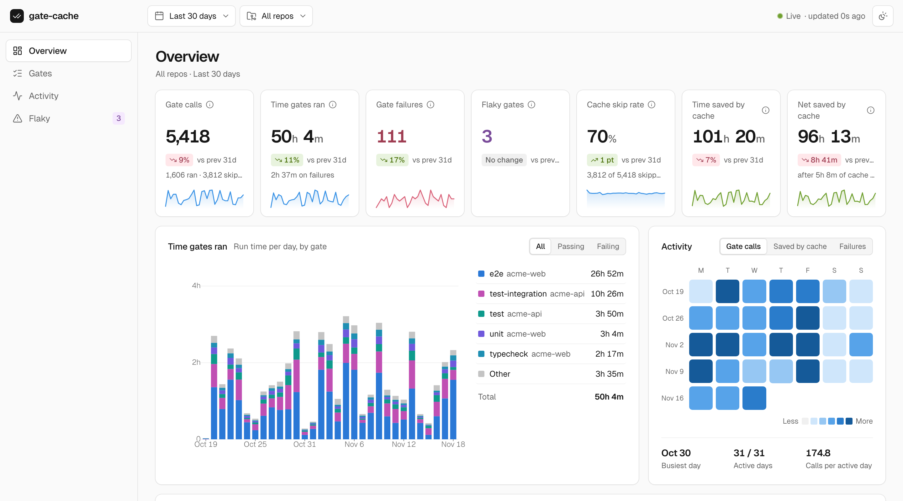
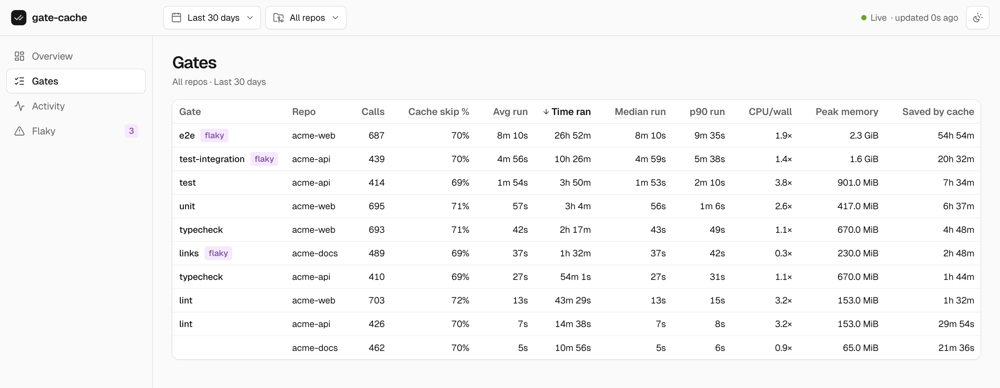
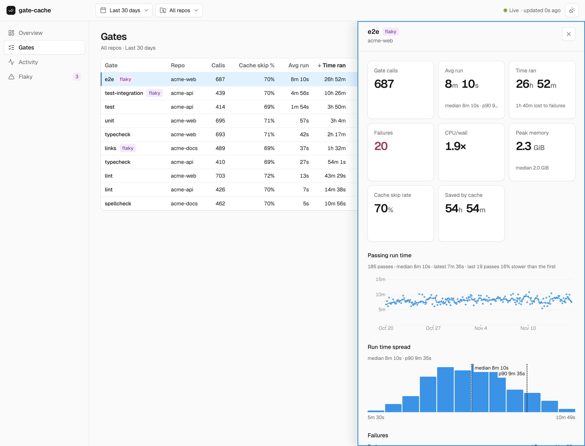
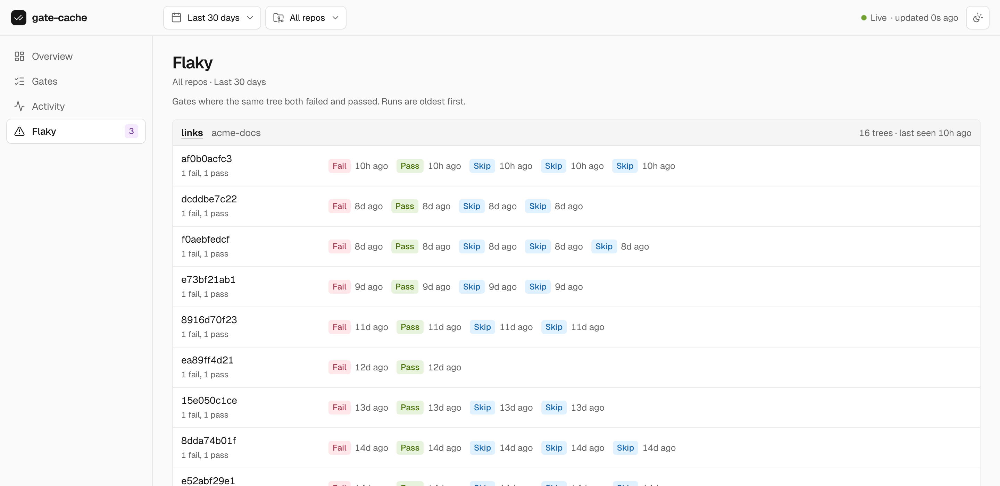
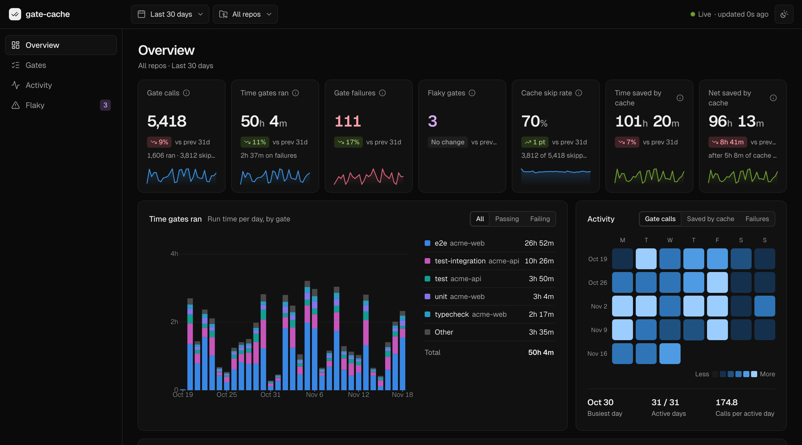

# gate-cache

Run fewer lints and tests, and learn what your checks cost.

**[Documentation](https://natelandau.github.io/gate-cache/)**

Developers and coding agents run the same lint and test commands many times on code that did not change. Each repeat run costs time, and a slow or flaky suite costs more. When agents write code, the number of tests grows fast, and so does the cost.

gate-cache has three goals:

1. **Save time.** gate-cache wraps a lint or test command and computes a hash of the content of every file in the repository. When the command already passed with the same hash, no file has changed, so gate-cache skips the command and exits 0.
2. **Help you manage your suites.** gate-cache can record each run. A local dashboard then shows flaky checks, slow checks, failures, and the time that each check costs and saves.
3. **Keep up with coding agents.** Agents run checks again and again, often in several worktrees at the same time. gate-cache gives agents clear messages and a guide of their own. When two runs of one check overlap, the second run waits for the first. If the first run passes, the second run skips.



## Install

gate-cache is a Python program, and it needs Python 3.11 or later on macOS or Linux. Your project can use any language. Install gate-cache with [pipx](https://pipx.pypa.io) or [uv](https://docs.astral.sh/uv/):

```sh
pipx install gate-cache
# or
uv tool install gate-cache
```

The [install guide](https://natelandau.github.io/gate-cache/get-started/install/) gives other ways.

## Quick start

A coding agent can add gate-cache to a project in any language. The agent asks you which commands to wrap and how, then makes the changes and stops before it commits.

1. Install gate-cache.
2. Open a coding agent, such as Claude Code or Codex, at the top of your repository.
3. Give the agent this prompt:

    ```text
    Run `gate-cache --prompt` and follow the instructions that it prints.
    ```

4. Answer the questions of the agent.
5. Run `gate-cache --help` to see the commands and options.

## Stats and the dashboard

gate-cache does not record stats until you turn recording on. With recording on, each run of a gate adds one event to a local file. The dashboard reads these events and shows:

- Which gates are flaky, that is, which gates both failed and passed with the same hash, on identical files.
- Which gates are slow, and which gates get slower over time.
- How much time the gates ran, and how much time the cache saved.
- Which gates fail, and what started each run: a git hook, CI, a terminal, or a coding agent.

To turn recording on, run:

```sh
gate-cache stats on
```

`gate-cache stats` shows whether recording is on and where the data is. `gate-cache stats off` turns recording off and keeps the data. Recording is off in CI.

To open the dashboard, run:

```sh
gate-cache dashboard
```

The dashboard opens in your browser at `http://127.0.0.1:7878`. Only a copy of gate-cache installed from PyPI includes the dashboard.

## Examples

Wrap a command. These examples use `pytest`, a test runner for Python. The second run skips, because no file changed:

```console
$ gate-cache -- pytest
============================= 412 passed in 94.20s =============================

$ gate-cache -- pytest
gate-cache: pytest already passed on tree aaff74984ccc, skipping (saved 1m 34s)
```

Give the gate a short name, so its history stays together when the command line changes:

```sh
gate-cache --name test -- pytest -x
```

Run a gate again only when its own files change:

```sh
gate-cache --name api-test --path api/ --path requirements.txt -- pytest api/tests
```

Run a gate again when an input that git does not track changes, such as the installed version of a tool:

```sh
gate-cache --name "test@node$(node --version)" -- npm test
```

If your project names its checks in a package file or a task runner, put the gate there, so that you, your git hooks, and your agents all run the same gate:

```json
{
  "scripts": {
    "test": "gate-cache --name test -- vitest run"
  }
}
```

Run a gate in a plain git hook:

```sh
#!/bin/sh
# .git/hooks/pre-push
exec gate-cache --name test -- pytest
```

If your project uses [prek](https://github.com/j178/prek) or [pre-commit](https://pre-commit.com) to run its git hooks, use the gate-cache hook:

```yaml
repos:
  - repo: https://github.com/natelandau/gate-cache
    rev: v0.10.0
    hooks:
      - id: gate-cache
        name: test
        args: [--name, test, --, npm, test]
```

See which gates passed with the current hash of your files:

```sh
gate-cache status
```

Run every command, with no skips:

```sh
GATE_CACHE_DISABLE=1 gate-cache --name test -- pytest
```

The [documentation](https://natelandau.github.io/gate-cache/) covers hooks, CI, coding agents, configuration, and more examples.

## Privacy

- Recording is off until you turn it on.
- The data stays on your computer. gate-cache never sends it anywhere.
- An event holds the gate name, the command line, timings, the outcome, the repository and branch, and the host name. The [privacy page](https://natelandau.github.io/gate-cache/privacy/) lists every field. An event holds no command output and no file content.
- The gate name and the command line are stored as plain text. Never put a secret in a gate name or in a command line.
- The dashboard listens only on `127.0.0.1`. Its one outside request loads a font from `cdn.jsdelivr.net`, and that request sends no stats.
- `gate-cache stats clear` deletes all recorded stats.

## More of the dashboard

The Gates page lists each gate with its run count, cache skip rate, run times, CPU use, peak memory, and time saved:



Click a gate to see its run time over time, the spread of its run times, and its failures:



The Flaky page lists each gate that both failed and passed with the same hash, with the runs for each hash:



The dashboard follows the theme of your system, and it has a light and a dark theme:



## Contributing

To build gate-cache, run the tests, or work on the dashboard, read [CONTRIBUTING.md](CONTRIBUTING.md).

## License

gate-cache is released under the [MIT License](LICENSE).
