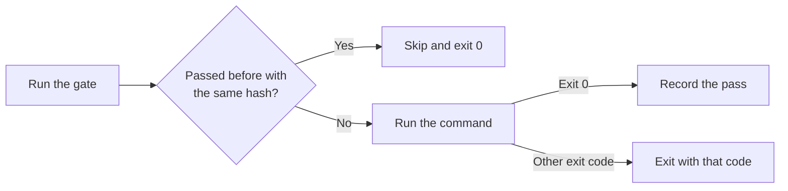

# Your first gate

A **gate** is a command that gate-cache wraps, such as a test or lint command. Each gate has a name. gate-cache records each pass of a gate, and skips the gate when it already passed with the same hash of your files.

Without gate-cache, one change often runs the same tests three times:

1. You run the tests in your terminal. They pass.
2. You commit. The pre-commit hook runs the tests again.
3. You push. The pre-push hook runs the tests again.

No file changed after step 1, so steps 2 and 3 cannot give a new result. With gate-cache, steps 2 and 3 skip, and each one finishes in a fraction of a second.

## Wrap a command

Put `gate-cache --` before the command. The examples on this site use `pytest`, a test runner for Python. Use your own test or lint command in its place.

```console
$ gate-cache -- pytest
============================= 412 passed in 94.20s =============================
```

The command passed, so gate-cache recorded the pass. Run the same command again without a change to the files:

```console
$ gate-cache -- pytest
gate-cache: pytest already passed on tree aaff74984ccc, skipping (saved 1m 34s)
```

gate-cache did not run the tests and exited 0. The time in parentheses is how long the command ran when it passed.

Now change a file, such as `src/app.py`, and run the gate again. A file changed, so the hash changed, and the tests run:

```console
$ gate-cache -- pytest
============================= 412 passed in 95.02s =============================
```

gate-cache computes a **hash** of the content of every file in the repository that git does not ignore, including uncommitted edits and new files. A change of one character in one file gives a new hash. Only a hash that is identical to the hash of a pass makes the gate skip. gate-cache prints the start of this hash as the **tree**, as in `already passed on tree aaff74984ccc`.



## Name the gate

Without a name, the command line is the name of the gate. Give the gate a short name with `--name`:

```sh
gate-cache --name test -- pytest
```

A short name is easier to read in `gate-cache status` and the dashboard. [Write a gate](../guides/write-a-gate.md) tells you when to give a name.

## See what passed

`gate-cache status` lists the gates that passed with the current hash, and the gates that failed with it:

```console
$ gate-cache status
tree  aaff74984cccd156a469afa7d9ab10e4777beb24

  gate           result   exit code   reason
 ─────────────────────────────────────────────────
  test           passed
  npm run lint   missed           1   exit code 1
```

## Run the command in full

To run every command with no skips, set `GATE_CACHE_DISABLE=1`:

```sh
GATE_CACHE_DISABLE=1 gate-cache --name test -- pytest
```

## Next steps

- If your project runs its checks through package scripts or a task runner, put the gate there, so that you, your git hooks, and your agents all run the same gate. Read [Recipes](../guides/recipes.md).
- Run the gate in a git hook. Read [Git hooks](../guides/git-hooks.md).
