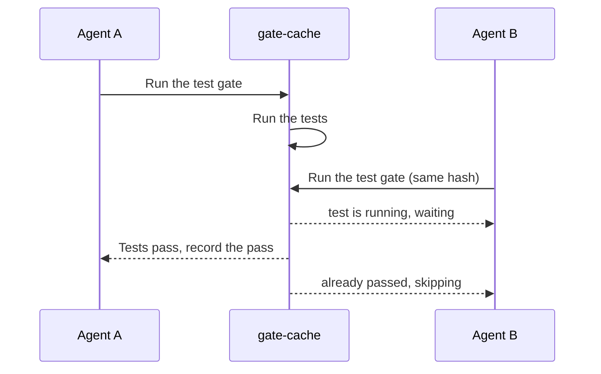

# Coding agents

Coding agents run lint and test commands again and again, often from several worktrees at the same time. gate-cache helps in three ways:

- An agent skips a check that already passed with the same hash, in any worktree of the repository.
- When two agents run the same check with the same hash at the same time, the second one waits for the first.
- gate-cache prints a guide for agents, so an agent knows how to read its messages and how to write a gate.

## Set up gate-cache with an agent

Give the agent this prompt at the top of your repository:

```text
Run `gate-cache --prompt` and follow the instructions that it prints.
```

The agent asks you some questions, then wraps your commands. [Quick start](../get-started/quick-start.md) lists the questions.

## Tell your agents to use the gates

A gate skips only when it runs through gate-cache with the same name. An agent that runs a tool directly, such as `pytest`, does not use the cache, and its pass does not help you, your git hooks, or the other agents.

Agents read the instruction file of the repository, such as `AGENTS.md` or `CLAUDE.md`. Add a section that gives the exact gate-cache command of each check. Replace the commands in this example with your own:

```markdown title="AGENTS.md"
## Checks

Run each check with the command below, exactly as written. Never run
the tools directly.

- Lint: `gate-cache --name lint -- ruff check .`
- Tests: `gate-cache --name test -- pytest`

Before you add or change a check, run `gate-cache --skill` and read
the guide.
```

If your project runs its checks through package scripts or a task runner, such as `npm test`, list those commands instead.

!!! tip

    The setup prompt in [Quick start](../get-started/quick-start.md) adds a section like this one for you.

## The agent guide

`gate-cache --skill` prints a guide for agents. It tells an agent what each gate-cache message means and what to do, how to write and scope a gate, and which actions to leave to you, such as deleting records. The guide always matches the installed version. You can read it on this site: [Agent guide](../reference/agent-guide.md).

To install the guide as a skill, save its output in the skills folder of your agent. For Claude Code:

```sh
mkdir -p .claude/skills/gate-cache
gate-cache --skill > .claude/skills/gate-cache/SKILL.md
```

!!! tip "Keep a saved guide current"

    A saved copy does not change when you upgrade gate-cache. Save it again after each upgrade.

## Several agents at the same time

Two runs of the same gate with the same hash often overlap. For example, an agent starts the test suite, and you commit before it finishes, with no change to the files. Without gate-cache, your pre-commit hook starts a second copy of the suite, and the two copies slow each other down.

With gate-cache, the second run waits for the first. The two runs can be in different worktrees of the repository.

```console
$ gate-cache --name test -- pytest
gate-cache: test is running in /work/app-feature (started 1m 12s ago), waiting
gate-cache: test already passed on tree aaff74984ccc, skipping (saved 1m 34s)
```

- If the other run passes, the waiting run skips.
- If the other run fails, the waiting run runs the command itself. This is the default, because a flaky gate can pass on a second try.
- To exit with the failure instead, give `--on-wait-failure report`. Use it for a slow gate whose failures are real, so that the waiting run reports the failure at once instead of spending the full run time to fail the same way.
- A run waits at most 15 minutes. Then it prints `running anyway` and runs the command.



!!! warning "Tool time limits"

    Some agents stop a command after a fixed time, such as 2 minutes. A wait can last longer. Run long gates in the background, raise the time limit of the tool, or give a smaller `--wait-timeout`. [Configuration](../reference/configuration.md#wait-for-a-run-in-progress) shows how to change the wait for every run.

Waiting works on macOS and Linux.

## See what agents run

When you [record stats](../stats/record-stats.md), gate-cache records what started each run. The dashboard shows the runs of Claude Code, Codex, and Gemini CLI apart from the runs of your git hooks, your terminal, and CI.
