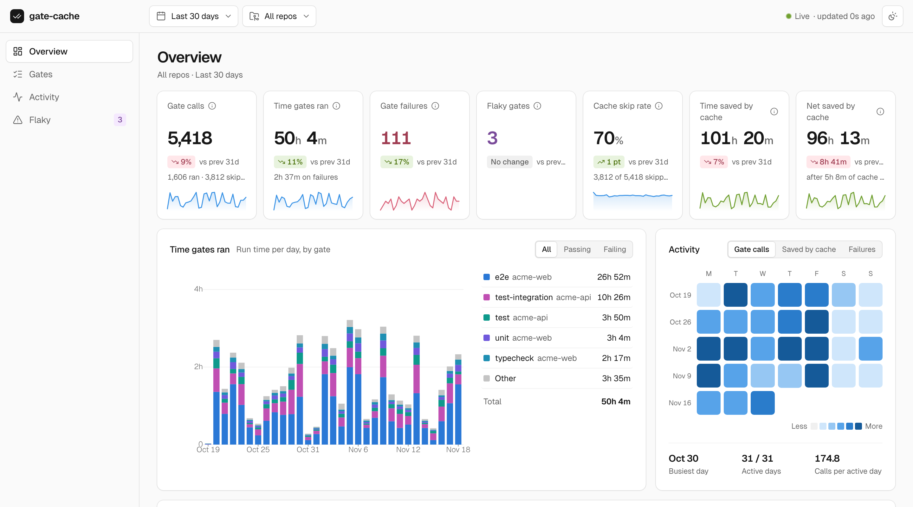

# gate-cache

Run fewer lints and tests, and learn what your checks cost.

Developers and coding agents run the same lint and test commands many times on code that did not change. Each repeat run costs time, and a slow or flaky suite costs more. When agents write code, the number of tests grows fast, and so does the cost.

gate-cache wraps a lint or test command. Before it runs the command, it computes a hash of the content of every file in the repository. If the command already passed with the same hash, no file has changed since that pass, so gate-cache skips the command and exits 0. It can also record each run, so that you can see which checks are slow, flaky, or expensive.

```console
$ gate-cache -- pytest
============================= 412 passed in 94.20s =============================

$ gate-cache -- pytest
gate-cache: pytest already passed on tree aaff74984ccc, skipping (saved 1m 34s)
```

<div class="grid cards" markdown>

-   :lucide-timer:{ .lg .middle } __Save time__

    ---

    Skip a lint or test command that already passed with the same hash of your files, in your terminal, your git hooks, and your agent sessions.

    [:octicons-arrow-right-24: Your first gate](get-started/first-gate.md)

-   :lucide-chart-column:{ .lg .middle } __Manage your suites__

    ---

    Record each run, then use a local dashboard to find flaky checks, slow checks, and the time that your checks cost.

    [:octicons-arrow-right-24: Record stats](stats/record-stats.md)

-   :lucide-bot:{ .lg .middle } __Keep up with coding agents__

    ---

    Agents run checks again and again, often in several worktrees at the same time. gate-cache gives agents clear messages and a guide of their own.

    [:octicons-arrow-right-24: Coding agents](guides/coding-agents.md)

</div>



## Features

- [Spend no time on checks that cannot give a new result](get-started/first-gate.md). If a lint or test command already passed on the same hashed content of your files, gate-cache skips it.
- [Run only the tests that your change can affect](guides/scope-to-paths.md).
- [Never skip a test that a new tool version or setting can break](guides/write-a-gate.md#cover-inputs-that-git-does-not-see).
- [Know how long a check takes before it runs](reference/commands.md#messages).
- [Explore your runs in a dashboard in your browser: flaky gates, slow gates, and the time each gate costs and saves](stats/dashboard.md).
- [Integrate with JUnit reports to see which tests are slow or flaky and need a fix](stats/test-detail.md).
- [Let a coding agent set up gate-cache in a project of any language](get-started/quick-start.md).
- [Keep your data private: stats stay on your computer and are off until you turn them on](privacy.md).

## Where to start

- To add gate-cache to a project with the help of a coding agent, read [Quick start](get-started/quick-start.md).
- To add gate-cache by hand, read [Install](get-started/install.md), then [Your first gate](get-started/first-gate.md).
- To see what your checks cost, read [Record stats](stats/record-stats.md).
