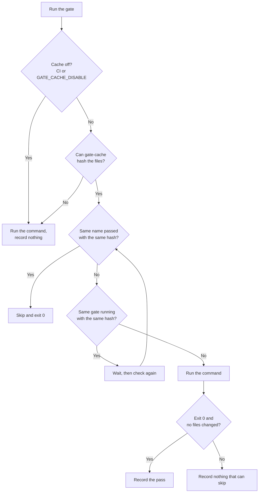

# How it works

This page explains when gate-cache skips a command, and what it cannot see.

## When a gate skips

gate-cache skips a command only when it has a record that the same gate passed with the same hash. In every case where it is not sure, it runs the command.

## What the hash covers

gate-cache computes a hash of the content of every file in the repository that git does not ignore. A change of one character in one file gives a new hash, and only an identical hash makes a gate skip. gate-cache prints this hash as the **tree**. The hash covers:

- Committed files.
- Uncommitted edits, staged or not.
- New files that git does not ignore.

A gate that passes on uncommitted work therefore skips when you commit those edits unchanged, because the hash is the same. gate-cache never stages files or changes your git index.

A gate [scoped to paths](../guides/scope-to-paths.md) computes its hash from only the files under its paths.

## What gate-cache cannot see

A record of a pass covers the gate name and the content of the files that git does not ignore, and nothing else. gate-cache does not see anything outside those files, such as:

- Files that git ignores, such as a virtual environment, or an `.env` file that `.gitignore` lists.
- The environment variables of the shell that runs the gate.
- The versions of the tools that are installed on the computer.
- External services.
- The working directory.
- The files that a symlink points to. The hash covers only the target path that the symlink stores.
- The commit message, the branch, or a remote.

After a change to one of these, a gate can skip when a new run would give a different result. Put such an input in the gate name, as [Write a gate](../guides/write-a-gate.md#cover-inputs-that-git-does-not-see) shows. After a tool upgrade, you can also run `gate-cache clear`.

## When the command runs without the cache

gate-cache runs the command and records nothing in these cases:

- `CI` or `GATE_CACHE_DISABLE` turns the cache off.
- The directory is not in a git repository.
- The directory is outside the files of the repository, such as when the `GIT_WORK_TREE` variable points to another directory.
- gate-cache cannot hash the files, such as during a merge conflict, in a sparse checkout, or when a submodule is not checked out or has local changes.
- A `--path` matches no file.
- A file differs from the copy that git writes when it checks out the file. Examples are CRLF line endings where `.gitattributes` or `core.autocrlf` makes git check out LF, and an executable bit that git ignores because `core.fileMode` is `false`.

gate-cache prints the reason.

## Shared records

gate-cache stores the records of passes in the `.git` directory of the repository. Your terminal, your git hooks, your coding agents, and every worktree of the repository share them. A record lasts 30 days. [Configuration](configuration.md) shows how to change this.

## Limits

- gate-cache runs on macOS and Linux.
- Waiting for another run of the same gate needs a file lock that macOS and Linux support.
