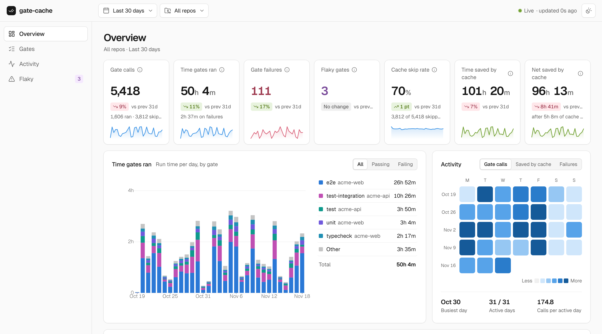
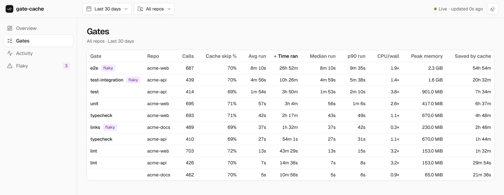
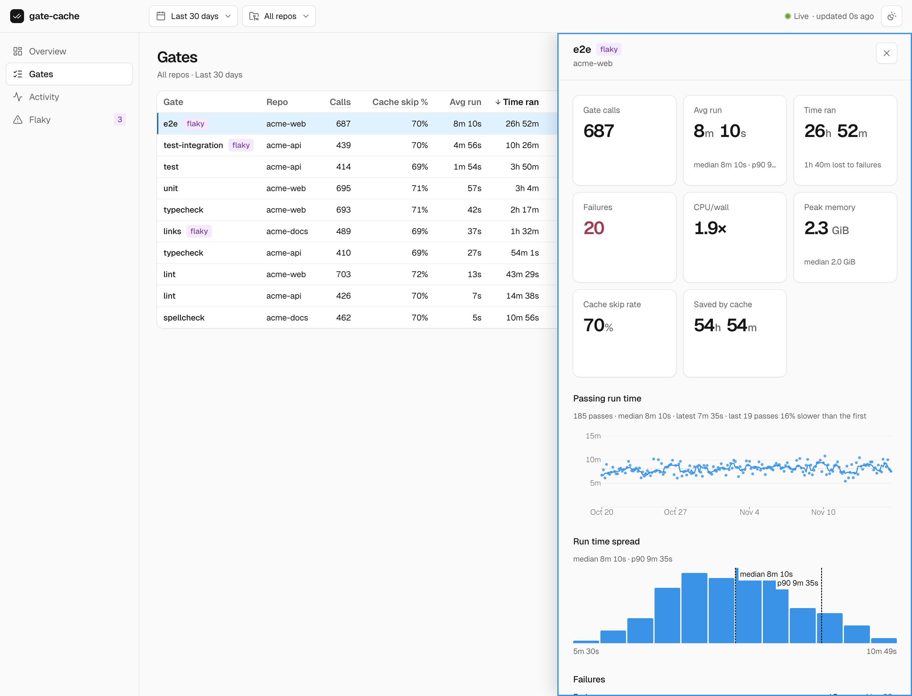
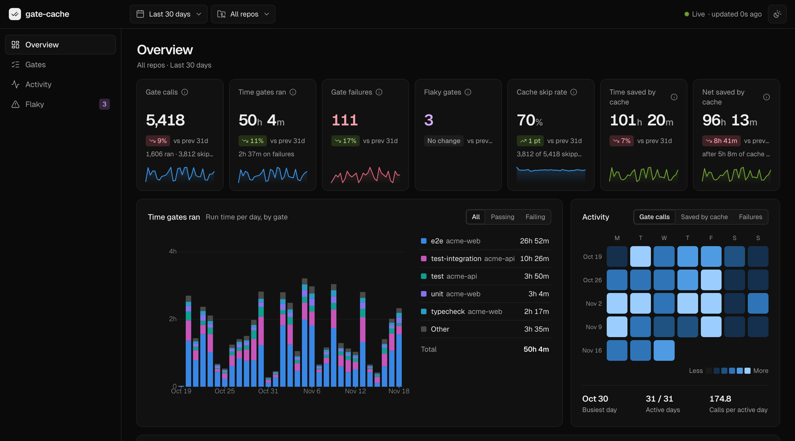

# The dashboard

The dashboard shows the runs that gate-cache recorded. Run `gate-cache dashboard` to open it. It updates while it runs, so new runs appear within seconds.

## Pick what to see

The bar at the top applies to every page:

- **Time range.** Pick a relative range, such as 7 days, a calendar period, such as This week, or custom dates.
- **Repositories.** Show one repository, several, or all of them.

Each number on the overview shows its change against the previous period of the same length.

## Overview

The overview answers "how are my checks doing?":

- **Stat cards:** gate calls, time that gates ran, time that the cache saved, failures, flaky gates, spot checks, and how often gates skip.
- **Time gates ran:** run time per day, split into the gates that took the most time.
- **Activity and daily charts:** when gates run, and how many fail. Click a day to scope the page to it, or drag across days to pick a range.
- **Recent failures** and **Gates getting slower.**
- **Top gates:** the gates that ran the longest, saved the most, ran the most, or failed the most.
- **Breakdown:** runs grouped by repository, gate, source, branch, or computer. The source is what started a run: a git hook, CI, a terminal, or a coding agent.

Click a count to see the runs behind it on the Activity page.

## Gates

One row for each gate, with its runs, how often it skips, its run times, CPU use, peak memory, and the time that it ran and saved. Click a column header to sort by it. Click a gate to open its details.

## Gate details

The details of a gate show its run time over time, the spread of its run times, its failures, and which sources ran it. If the gate records its test reports, the details also list its slowest tests. Read [Find slow and flaky tests](test-detail.md).

## Activity

A list of runs, newest first. To filter the list, click **Filter** and pick a filter:

- **Outcome:** the runs with the outcomes that you select, such as failures or skips.
- **Gate:** the runs of the gates that you select.
- **Reason:** the runs that ran without the cache for the reasons that you select.
- **Date range:** the runs between two dates that you enter, From and To.
- **Group by:** the runs of one repository, gate, source, branch, or computer.
- **Flaky trees:** only the runs on identical files (the same hash) with which the same gate both failed and passed.
- **Spot checks:** only the runs that the cache could have skipped, but ran to confirm that the cache is still correct.

For Outcome, Gate, and Reason, you can select more than one value. The list then shows the runs that match any of the values. When you apply more than one filter, the list shows only the runs that match all of them.

Each filter shows as a chip, such as "Outcome is Fail, Skip". Click a chip to change the filter. Click the **x** on a chip to remove the filter, or click **Clear all** to remove all filters.

## Triage

The gates that need a look, one row for each gate and reason, newest first. A gate is on the list when it failed and then passed on identical files, or when a test passed only on a retry (**Flaky**), or when a spot check of it failed (**Failed spot check**). Each row says what to check and shows the runs behind it. For a gate that records its test reports, a **Flaky** row also lists its flaky tests and the tests that passed on a retry. The **Reason** list limits the page to one reason. The number beside **Triage** in the sidebar is the count of rows. Read [Triage gates](triage.md) and [Find slow and flaky tests](test-detail.md).

## Theme

The button at the top right switches between the theme of your system, light, and dark.

